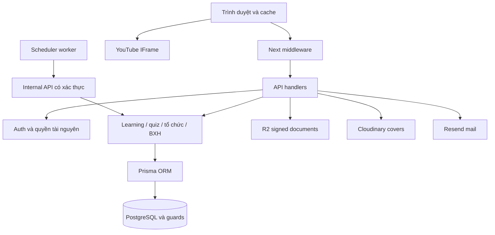

# Kiến trúc hệ thống

Next.js 14 App Router chạy UI và API trong cùng ứng dụng, TypeScript/Tailwind, Prisma ORM 6/PostgreSQL. Video dùng YouTube IFrame; tài liệu dùng S3-compatible Cloudflare R2; cover upload server-side qua Cloudinary; email qua Resend. Dự án không dùng Prisma Composer.

## Ranh giới mã

| Khu vực | Trách nhiệm |
|---|---|
| `src/app` | Trang/layout và `api/v1`, `api/internal`; URL là hợp đồng hiện hữu |
| `src/components` | Điều hướng, form, UI và YouTube player |
| `src/lib/api/client.ts` | Fetch, refresh, cache/dedupe, invalidation |
| `auth.ts`, `authorization.ts`, `chapter-lead.ts`, `affiliation-access.ts` | Status, chức vụ và resource scope |
| `video-*`, `progression.ts`, `learning-unlocks.ts` | Playback đã ACK, progress/replay và mở bài |
| `quiz-submission.ts`, `quiz-attempt-rules.ts`, `quiz-pool-selection.ts` | Chấm bài, snapshot, high-water, auto-submit |
| `learning-*`, `shared-learning-path.ts`, `course-requirements.ts` | Cycle/cutover/readiness, nghĩa vụ/deadline, bổ sung bài |
| `chapter-*`, `organization-transition.ts` | Roster, Lead binding, transfer, affiliation/history |
| `competition-snapshots.ts`, `period-leaderboard.ts`, `chapter-term-results.ts` | Facts thời gian, snapshot và phân bổ kết quả |
| `scripts/db`, `scripts/audit`, `scripts/test`, `scripts/perf` | Công cụ nhóm theo mục đích, giữ tên npm commands |
| `scripts/learning-scheduler.mjs` | Entrypoint worker |
| `prisma` | Schema, SQL migrations bất biến, seed, bootstrap |
| `load-tests` | Harness tải có guard, profiler/runner, fixture private |
| `artifacts` | Output tự sinh, Git bỏ qua, không phải cấu hình nghiệp vụ |

## Dữ liệu

[schema.prisma](../prisma/schema.prisma) là nguồn chính, hiện **57 model**. Không duy trì ERD 15 bảng/DBML cũ song song. Constraints/triggers trong SQL migrations cũng là phần của hợp đồng dữ liệu.

- Auth: User/status, refresh token, invitations/reset, restriction/audit.
- Tổ chức: Chapter/ChapterMember legacy, OrganizationUnit/Membership, Position/Assignment, tenure/history, Lead binding, reorganization batch/items.
- Nội dung: Course→Session→Lesson→Video/Documents, Assessment/Question/Options, bank/pool/version/draft.
- Học: lifetime progress, LearningCycle/CycleLessonProgress, MonthlyVideoReplay, immutable attempt question/grading evidence, StarLedger và reward high-water.
- Policy: bốn program, 18 target, mandatory rules/assignments/path/budget history, requirement/publication snapshot và supplemental obligation.
- Kỳ: CompetitionMonth, competition/actual terms, KPI, frozen LearningSnapshot và temporal history.
- Đồng bộ: LearningOutbox retry/backoff; không thay core reset atomic trong transaction.

Giữ timestamp legacy, không suy diễn term cho ledger cũ. Sao `LEGACY`/chưa phân bổ được báo riêng; không sửa bằng cleanup tổng quát.

## Xác thực và quyền

Middleware bảo vệ điều hướng; handler/service vẫn kiểm tra quyền. `authenticate` nhận Bearer/cookie, verify token rồi đọc User/status/affiliation và Lead scope từ DB mỗi request. `invalidateUserAuthCache` còn là hàm tương thích mutation; không còn status-cache 30 giây như context cũ.

Role legacy chỉ là một phần. Chức vụ hiệu lực, loại đơn vị/quyền tài nguyên quyết định thao tác. Lead cố định một Chapter, JWT cũ không giữ quyền đã thu hồi. DB guards chặn dual Chapter/DNA, tenure Lead chồng lấn/đổi binding cả import/concurrency. Admin có nhánh toàn hệ thống riêng.

Cookie login/refresh có HttpOnly, Secure ở production; client hiện vẫn lưu token theo cơ chế localStorage sẵn có, không phải cookie-only. Document route kiểm tra quyền trước ký/download. Object prefix `docs/` là nơi lưu tài liệu bài học, **không liên quan** việc output repo chuyển sang `artifacts/`.

## Learning và transaction

1. Legacy hoạt động trước cutover; Admin duyệt mapping/rules/aliases/season/readiness trước đặt future cutover.
2. Sau cutover, context gồm tháng UTC+7, cycle học và cửa sổ thưởng. Training completion, monthly replay và sao là facts riêng.
3. Heartbeat kiểm tra video/session, lock user/context, tăng furthest theo elapsed bounded. ENDED có dung sai nhỏ, không bỏ chứng cứ watch time.
4. Manual/auto submit dùng chung service, snapshot đề/grading, bảo vệ expiry/cycle cũ và high-water idempotency.
5. Apply transfer snapshot/reset atomic rồi enqueue từng người; retry outbox không reset lại. DNA boundary riêng; scheduler trễ dùng DB clock thực.
6. Tháng/kỳ đóng dùng saved snapshot. Pending KPI chỉ hoàn thiện phần KPI; thiếu data trả reason. Không tính quá khứ theo roles hôm nay.

## Cache và request cũ

Client có memory GET TTL 30 giây, sessionStorage cho đường phù hợp, in-flight dedupe và refresh 401. Tập route chuyển tab có memory-only tab cache tối đa 30 entries, chung trên `window` giữa layout/page chunk và gắn identity; không serialize tab data vào sessionStorage. Giữ invalidation prefix sau mutation.

Server cache riêng theo role/scope/loại dữ liệu: course list TTL 15 giây, leaderboard/progress/roster có helper riêng. Policy/readiness/progress nhạy cảm có no-store. Cache không thay quyền DB đang có hiệu lực. Tách component/hook phải giữ request identity, cancellation/stale guard, effect dependencies, payload/loading/error và React key để không remount ngoài ý muốn.

## Scheduler

Worker phút gọi internal endpoints cho cutover tới hạn, apply transfer, DNA reset, outbox/retirement, đóng tháng/kỳ, auto-submit/deadline. Vercel daily cron là fallback, không bảo đảm cadence phút. Overlap guard trong process phối hợp DB lock/idempotency; cần provision/giám sát lag và lỗi. Xem [operations](operations.md) và [business-rules](business-rules.md).
